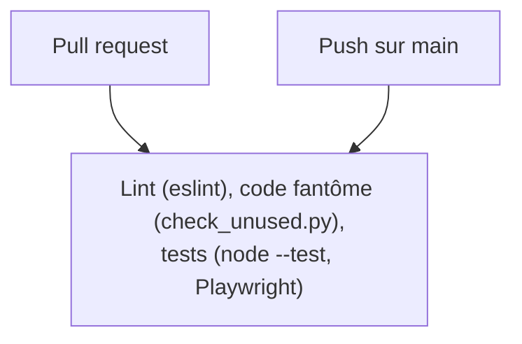

# Déploiement

## itch.io

Le jeu est fait de fichiers statiques, sans serveur : itch.io les héberge. `python tools/build_itch.py` construit
`dist/arcadepipe-itch.zip` : les fichiers du jeu, avec le numéro de version (`3.<nombre de commits>`).

1. Sur itch.io, dans le projet de type *HTML* (`https://pazpop.itch.io/arcadepipe`), déposer l'archive et cocher
   *This file will be played in the browser*.
2. Dimensions de l'affichage : 960 × 540 (le jeu est en 16:9), avec le bouton plein écran.

Le kit presse (`frontend/press/`) et les textes des pages itch.io et YouTube
([`descriptions-itch-youtube.html`](descriptions-itch-youtube.html)) restent dans le dépôt : ils ne sont pas dans
l'archive.

## CI/CD

Tout est dans `.github/workflows/tests.yml`, hormis l'audit hebdomadaire. La CI ne construit ni ne publie rien :
l'archive d'itch.io se fait à la main.

- Actions GitHub épinglées par SHA de commit : un tag peut être redéplacé, un SHA non.
- [Dependabot](../.github/dependabot.yml) ouvre une PR à chaque mise à jour (`npm`, `github-actions`).
- `.github/workflows/audit.yml` lance `npm audit` chaque lundi : une faille publiée entre deux pushs dans une
  dépendance fait échouer ce workflow, et GitHub prévient par courriel. GitHub le suspend après 60 jours sans activité
  dans le dépôt.
- `overrides` de `frontend/package.json` force `minimatch` en version 11 (GHSA-g3hv-75wg-m249), qu'ESLint ne demande pas
  encore : à retirer dès qu'il la demande.
