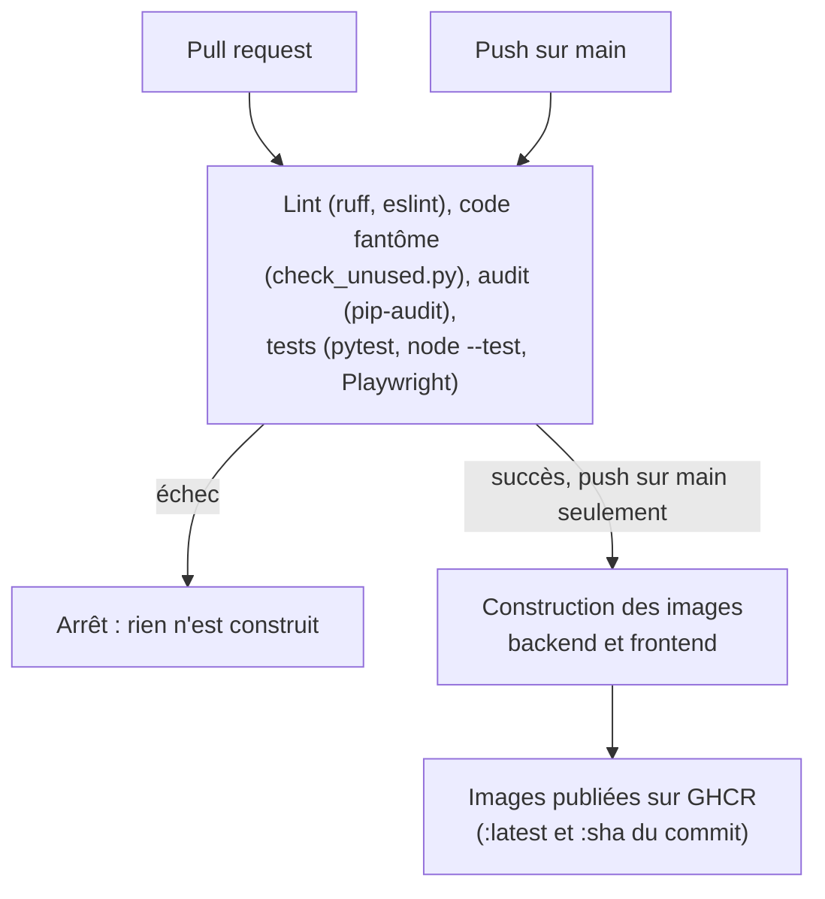

# Déploiement

## Docker (autonome)

`docker-compose.yml`, à la racine, est le seul fichier de déploiement Docker de ce repo. Il fait tourner tout le jeu (backend + frontend) sans dépendance externe, publie le port 80 et garde les protections de sécurité (non-root, rootfs read-only, `cap_drop: ALL`, rate limiting, CORS). Caddy (frontend) route lui-même `/api/*` vers le backend.

```bash
docker compose up --build -d
# -> http://localhost
```

Port 80 déjà pris ? Changer le mapping `"80:80"` du service `frontend` (ex. `"8080:80"`).

## itch.io

itch.io héberge les fichiers du jeu chez lui ; le classement, lui, reste sur `arcadepipe.pazpop.net`. `python tools/build_itch.py` construit `dist/arcadepipe-itch.zip` : les fichiers du jeu, avec l'adresse complète de l'API dans `site-config.json` (`apiBase`) et le numéro de version.

1. Sur itch.io, créer un projet de type *HTML*, y déposer l'archive et cocher *This file will be played in the browser*.
2. Dimensions de l'affichage : 960 × 540 (le jeu est en 16:9), avec le bouton plein écran.
3. Autoriser l'adresse d'itch.io à appeler l'API : ajouter son origine, `https://html-classic.itch.zone`, à `ALLOWED_ORIGINS` du backend, à côté de celle du site (variable d'environnement du service `backend` : une clé `environment:` à ajouter dans `docker-compose.yml` ; pour l'instance publique, elle est dans le dépôt d'infra). Sans cela, le jeu fonctionne mais affiche « Classement indisponible » et n'enregistre aucun score. Cette origine est commune à tous les jeux d'itch.io : voir [sécurité](securite.md).

## CI/CD



Tout est dans `.github/workflows/image.yml`, hormis l'audit hebdomadaire. Une pull request (celles de Dependabot comprises) s'arrête après les vérifications : seul un push sur `main` construit et publie les images. La CI ne déploie rien.

- Actions GitHub épinglées par SHA de commit, images de base épinglées par digest : un tag peut être redéplacé, un SHA ou un digest non. Elles sont téléchargées depuis `mirror.gcr.io`, le miroir de Docker Hub tenu par Google (mêmes images, même digest) : une panne de Docker Hub ne bloque pas la construction.
- [Dependabot](../.github/dependabot.yml) ouvre une PR à chaque mise à jour (`pip`, `npm`, `github-actions`, `docker`).
- `.github/workflows/audit.yml` lance `pip-audit` (déjà lancé à chaque push) et `npm audit` chaque lundi : une faille publiée entre deux pushs dans une dépendance fait échouer ce workflow, et GitHub prévient par courriel. Il ne couvre pas les paquets système des images, et GitHub le suspend après 60 jours sans activité dans le dépôt.

Ce repo ne connaît ni VPS ni serveur cible. L'instance `arcadepipe.pazpop.net` est déployée à la main depuis le dépôt privé `infra-pazpop-hetzner` (fiche `ansible/applis/arcadepipe/`). Le Caddy de l'infra est devant : il envoie `/api/...` au backend et le reste au frontend. Le jeu est aussi sur itch.io (voir plus haut). Un fork n'a besoin de rien de tout ça : voir la section Docker ci-dessus.

Les images sur GHCR sont **privées** : le serveur les télécharge avec un jeton de lecture, rangé dans le dépôt d'infra.
